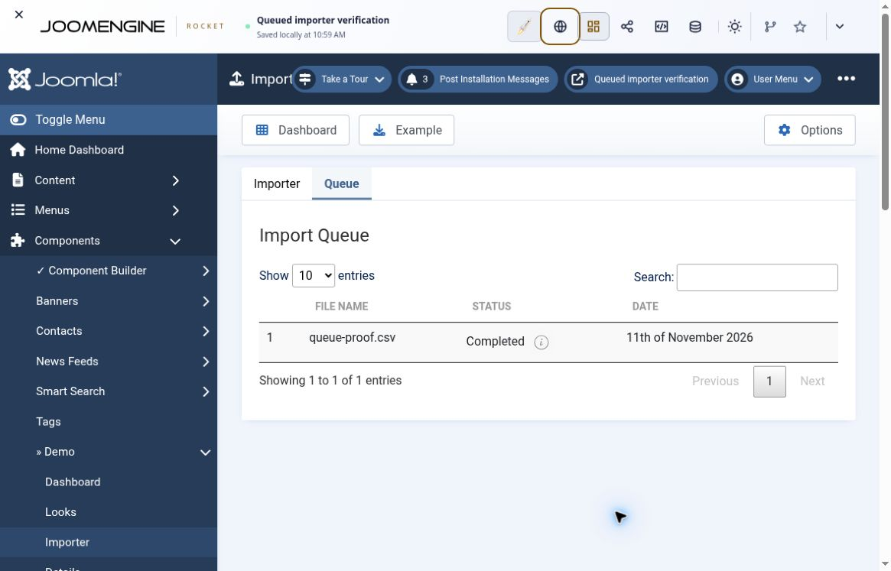
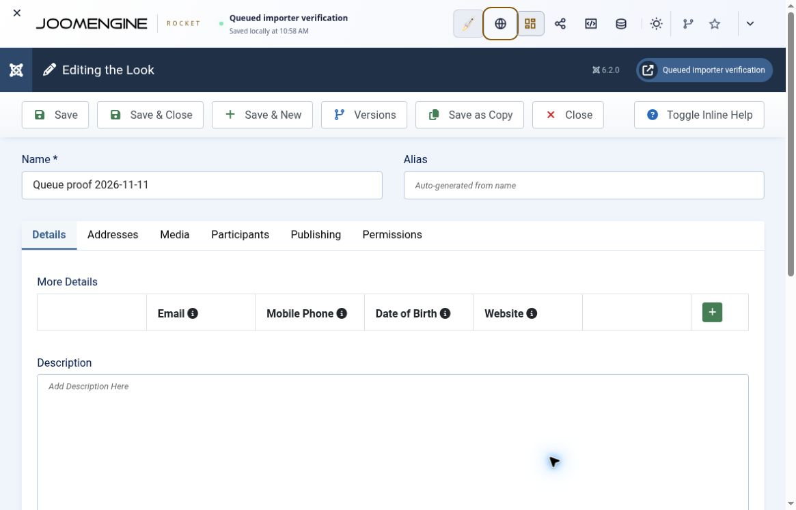

# Native importer building-block evidence

Inspected **11 November 2026**. This receipt supports the [immediate authoring map](../workflows/translation-import.md#author-the-native-jcb-graph), [Demo queue map](../workflows/staged-import.md#native-record-map) and [short concept map](../../architecture/concepts.md). It distinguishes source reconstruction, existing-feature execution and a complete newly authored build. No importer, compiler or upstream blueprint code was changed in this documentation task.

## Source authority and provenance

| Source | Inspected revision and use |
| --- | --- |
| [Core JCB](https://github.com/joomengine/Joomla-Component-Builder/tree/037752c7e6599aa4cec900138dfb61af7ee4ba8f) | `6.x@037752c7e6599aa4cec900138dfb61af7ee4ba8f`: rechecked immediate View/Model/controller, Templates/Layouts, helper, Ajax input dispatch and compiler insertion points. This is the final authority for JCB implementation and compilation behavior. |
| [Packages](https://github.com/joomengine/packages/tree/4fd6ce1f2a11a478abb291d03a1a3b32ceeda5c9) | `master@4fd6ce1f2a11a478abb291d03a1a3b32ceeda5c9`: published Demo native graph, read through the advertised [Codefloe mirror](https://codefloe.com/joomla/packages). |
| [Super Powers](https://github.com/joomengine/super-powers/tree/9cd980492bed4c8177a6e32b703641950ec93604) | `master@9cd980492bed4c8177a6e32b703641950ec93604`: actual `settings.json`/`code.power`, providers and processor construction, read through the advertised [Codefloe mirror](https://codefloe.com/joomla/super-powers). |
| [Playground](https://github.com/joomengine/playground/tree/c49d02588d1a5276ab78d3dc3f5e3df19d30e463) | `main@c49d02588d1a5276ab78d3dc3f5e3df19d30e463`: native startup-command implementation; live `assets/manifest.json` reported the same source commit. |

Mirror discovery used the current [JCB community network](https://api.joomlacomponentbuilder.com/v1/network/community/jcb/). These hashes identify inspected sources, not required installation versions. The runtime exercise used the installed JCB definitions and configured repositories; it did not establish that every runtime record/Power was byte-identical to the independently inspected catalogue tips.

## Immediate source-to-authoring result

The [source Model](https://github.com/joomengine/Joomla-Component-Builder/blob/037752c7e6599aa4cec900138dfb61af7ee4ba8f/admin/src/Model/Import_translationsModel.php) and [View](https://github.com/joomengine/Joomla-Component-Builder/blob/037752c7e6599aa4cec900138dfb61af7ee4ba8f/admin/src/View/Import_translations/HtmlView.php), their callers and the compiler establish a native reconstruction:

- Custom Admin View linked to an Item Dynamic Get with custom PHP source. The getter supplies session-owned `guid` and `file_type` through the literal `$data =` contract.
- Native controller/model, Ajax and document hooks, with their enable flags; uploader Template; mapping/help Layouts; shared helper/header definition; Libraries/files and canonical Powers.
- One `adminForm`; inline mapping controls rather than invented persistent Field identities; synchronous `Import.Transient`, not a queue.

The complete field map and pinned core compiler proofs are in the [workflow](../workflows/translation-import.md#author-the-native-jcb-graph). The source is sufficient to author the native graph; a fresh reconstruction must still be compiled and tested. Static reference traversal from the inspected factory/utility roots found 133 Power definitions with no unresolved GUID references in that catalogue snapshot. This is metadata/source closure, not proof that every class executes or that a generated consumer packages every library. Shared providers also reference persistent/console services; their presence does not impose queue storage on the immediate path.

Original immediate UI record GUIDs were not recovered from the inspected catalogues/seeds. The default package Custom Admin View index and installation seed identify the Demo queued importer instead. **This is a provenance limit, not a build blocker:** create new application records and reuse existing Powers. Do not present a new reconstruction as an unchanged Pull of the original upstream blueprint or substitute Demo identities for the immediate feature.

This investigation did **not** create/import/compile a reconstructed immediate blueprint. The separate [10 November synthetic workbook receipt](language-strings.md#synthetic-workbook-import-and-translated-recompilation) demonstrated the existing immediate screen's XLSX upload, inspected mapping, saved translations and translated recompilation. It did not prove exported-example recovery, arbitrary domain adaptation, preservation of unmapped languages, cancellation, ownership edge cases or every advertised format.

## Demo queued runtime exercise

**Target:** isolated Playground, Joomla **6.2.0**, JCB **6.2.0**, PHP **8.4.27**. The site already contained native Demo J6 authoring records. No direct database write, generated-file patch, external importer script or shell subprocess was used to produce the imported row.

1. In JCB Compiler, compile **Demo J6** with its associated plugins. The observed results included component **6.0.1** and console **DemoCommands 2.0.0**. Install the component through Compiler.
2. Install the separately compiled console plugin. The verified native Playground route was **Additional setup steps → startup command** `extension:install` with the argument `--path=/persist/www/tmp/plg_console_democommands_v2_0_0__J6.zip`. Use the actual generated path on another build, not this versioned path blindly. Review unrelated setup inputs before applying changes; the test cleared the extension-URL input to avoid reinstalling JCB.
3. Open Joomla **Plugins** and enable **Console - DemoCommands**. It was disabled immediately after installation. Without activation, its command does not register.
4. Open Demo **Importer**, upload a synthetic `queue-proof.csv` with `Name,GUID` headers, and inspect the mappings: `Name → look.name`, `GUID → look.guid`. Submit the map. The queue showed **Awaiting**.
5. Replace the startup command with `demo:item:import`, with no arguments, and apply it to the **same saved site**. Playground Activity recorded the native command running. This exercises Joomla's console plugin, not a separately implemented importer.
6. Reopen the queue: **Completed**. Open Demo **Looks** and reopen the created row: Name `Queue proof 2026-11-11`, GUID `ebadf450-f0dc-4ae1-936d-278aa4408240`, local ID 1. The GUID is a disposable runtime fixture identity, not an authoring GUID or an identifier to reuse in production.

The [Playground launcher](https://github.com/joomengine/playground/blob/c49d02588d1a5276ab78d3dc3f5e3df19d30e463/src/joomla/index.mjs) validates startup commands and [console bridge](https://github.com/joomengine/playground/blob/c49d02588d1a5276ab78d3dc3f5e3df19d30e463/src/joomla/php/console.php) boots Joomla's real ConsoleApplication with ArgvInput and BufferedOutput. This provides a supported native execution path in the browser-hosted runtime. It is not evidence of unattended scheduling or cron. Check the target's actual command registration and current controls before adapting the procedure.

The screenshots show the completed job and created row's name. The GUID was separately inspected in the row's publishing fields. A Playground resume URL is not a hosted copy of the browser-local database; no cross-browser site export/restore was tested. The generated ZIPs were observed in Compiler results but not retained as local artifacts from this exercise.

### Observed failure and unverified stages

| Stage | Actual result |
| --- | --- |
| Native compilation, component/plugin installation and plugin activation | Completed on the target above. |
| CSV upload, inspected mapping, job save, real processor invocation, completed status and saved parent row | Passed for one synthetic create. |
| Example download → edit that download → import | Attempted download did not yield a captured artifact; this round trip remains unverified. The successful input was separately constructed. |
| Queue message-info icon | **Failed:** clicking it produced `SyntaxError: Unexpected end of input`, with malformed quoted `onclick` markup and literal row-property arguments. The same defect is present in the inspected queue Template. Other message-opening routes were not comprehensively tested. |
| Message-log table agreement | **Source inconsistency:** Persistent.Entity defaults to `message_log`; Demo schema/endpoint uses `importer_message_log`, and the inspected ItemImport configuration does not align them. Actual message persistence/rendering was not validated. The successful job must not be reclassified as failed on this source finding alone. |
| Update/replay, joins, malformed or missing file, invalid mapping, row failures, cancellation/cleanup, retry/restart, volume, concurrency, cron and permissions | Not tested in this exercise. |
| Package catalogue import/export and newly authored reconstruction | Not tested: the compiled Demo started from preinstalled authoring records. The named graph is a relevant workflow slice, not a complete transitive package-closure validation. |

Correct the maintained Template/configuration and regenerate before promising the affected message behavior in a new application. Keep the [queued acceptance cases](../workflows/staged-import.md#acceptance-and-failure-recovery), including real saved messages and failure/retry checks. The source worker's non-atomic waiting/processing sequence and zero exit status after counted failures remain independent limits; one successful create proves neither concurrency safety nor complete error handling.

## Scope of the skills update

The update documents verified building blocks and clarifies how native records fit together. It does not perform a full fresh-agent application build or promote either reference to a universal production-ready importer. Repository static checks and independent documentation review are recorded with the PR; they validate documentation consistency, not additional runtime cases.
